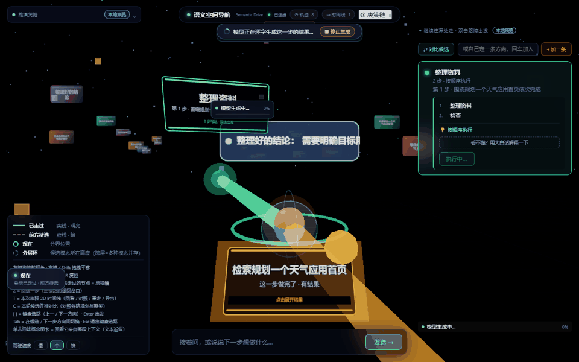

<div align="center">

# 🚗 Agent 3D Cockpit

**Turn agent collaboration from reading replies into driving a journey.**

[](prototype/CHANGELOG.md)
[](docs/PROBLEM.md)
[](prototype/requirements.txt)
[](LICENSE)
[](CONTRIBUTING.md)

[简体中文](README.md) · **English** · [日本語](README.ja.md) · [Deutsch](README.de.md) · [Français](README.fr.md) · [Español](README.es.md)

[Quick Start](#-quick-start) · [Core Idea](#-core-idea-why-driving-not-chatting) · [Honesty by Design](#-honesty-by-design) · [Research Docs](#-research-documentation) · [Roadmap](#-roadmap) · [Contributing](#-contributing)


*▲ Real runtime capture: type a question → latent path skeleton appears → forecast returns and lights up five candidate road signs. Execution backend is a local model; forecast provenance is honestly labeled in the UI.*

</div>

---

## What is this?

**Agent 3D Cockpit** is a runnable research prototype plus an interdisciplinary research framework exploring one question:

> When an AI agent works for you, how can you **see the directions, make choices, verify progress, and review history** — instead of staring at a progress bar guessing "what is it actually doing?"

It maps agent collaboration onto a 3D drive:

| Collaboration question | Cockpit expression | Your capability |
| --- | --- | --- |
| What could happen next? | **Road signs & forks** ahead | Compare directions before departing |
| How do options differ? | Road shape, spatial layout, side-by-side comparison panel | Understand choices instead of blindly clicking "continue" |
| Where are we now? | **Driving + streaming token output** | Follow real execution signals |
| What did this step produce? | **Arrival sign + result card** (elapsed / tokens / provenance) | Open and verify the artifact, not just a "done" badge |
| Why are we here? | Traveled trajectory, 2D timeline, decision chain | Review, compare, re-fork from any node |


## ✨ Features

- **Forecast-driven roads**: the backend samples candidate directions and computes divergence — low divergence renders a straight road, high divergence renders forks. Road shape *is* the visualization of semantic structure, not decoration.
- **Semantic bucketing**: synonym-cluster folding + farthest-point backfill guarantees five signs are five genuinely different directions, not paraphrases of one.
- **Honest execution chain**: a single real streaming LLM call; progress = actual output length. Four-state `source` (`llm / fast / local / offline`) labeled per round — local fallbacks never impersonate model inference.
- **Verifiable provenance**: result cards carry elapsed time, tokens, execution chain, and source; the proof bar shows divergence D, cluster mapping, and road type.
- **Multi-turn memory & replay**: session-level per-round ledger, 2D timeline (review / side-by-side compare / re-fork / export JSON·CSV), decision trace chain.
- **Interruption is a third state**: "Stop generating" truly aborts the backend stream. Interrupted ≠ completed ≠ failed; partial text is preserved and honestly labeled.
- **Keyboard-equivalent view**: `[` `]` to select, `Enter` to depart, `Tab` to switch groups — 3D is not the only channel.
- **Built-in experiment apparatus**: `?mode=opaque / transparent-nolink / decorative / no-fingerprint` switches A/B/B0/B1/B2/C control groups for human studies.
- **MCP toolset**: `tools/cockpit_mcp_server.py` exposes the cockpit as agent-callable tools (forecast / execute / health / open).
- **MoE fingerprint ring** (research branch): real expert-routing signals encoded as a 3D ring — same-prompt r=0.990, cross-topic max=0.079 — distinguishing "the model actually changed its approach".



*▲ Real runtime capture: pick a "next step" sign → camera drives along the new segment → arrival sign and result card take over on docking.*

## 🧭 Core Idea: Why "Driving", Not "Chatting"

Chat boxes answer well but poorly convey **relationships between directions**: which options are parallel choices, which are sequential dependencies, which were tried and reverted. The cockpit unfolds the timeline into space:

```
divergence → forks     candidates → signs     execution → driving
results → arrival      history → rear-view    re-choice → re-forking
```

Two disciplines intersect here (see [docs/SUBDISCIPLINES.md](docs/SUBDISCIPLINES.md)):

1. **Vector-space context visualization** — are candidate directions genuinely different in semantic space (bucketing, inter-cluster distance)?
2. **3D path-space HCI** — does each visual "advance" correspond to real work?

They must attest to each other. Semantic progress invisible in the path, or flashy paths with hollow execution, is what we call a **bidirectional broken link** — the hypothesized mechanism behind user feedback "the interface shows no substantive progress" (pending human-study validation).

## 🛡️ Honesty by Design

We audited our own prototype and found the old execution chain's intermediate steps ("retrieval", "verification") were **theater** driven by `sleep(0.09)` — the progress bar moved, no work happened. The audit, runtime evidence, and fix are fully public in [docs/AUDIT.md](docs/AUDIT.md) and [docs/RUNTIME-AUDIT.md](docs/RUNTIME-AUDIT.md).

Runtime timing showed the old chain's `task_update` intervals sat uniformly at 90–100 ms with zero spread — the fingerprint of sleep; in that record, fake cadence occupied ~86% of total duration (a diagnostic figure for that record only). After the fix: the uniform cadence disappeared, and token streaming covered 60–70% of execution time.

This established four **substantive-progress criteria (P1–P4)** as a pre-implementation gate for all development:

| Criterion | Must answer | Counter-example |
| --- | --- | --- |
| **P1 Reality** | Did the task/artifact actually change? | Only sign colors changed; the report untouched |
| **P2 Verifiability** | Can the user verify it themselves? | Only "done", no artifact or evidence |
| **P3 Attributability** | Which step / who did it? | Attributing one generation to retrieval+verification that never ran |
| **P4 Perceptibility** | Is it recognizable in the UI? | Backend worked; UI shows an abstract percentage |

Engineering red lines across all versions: **no fabricated completion signals, no fabricated data, interruption never impersonates completion, local fallback never impersonates the model.** Regression suites lock these invariants.


## 🚀 Quick Start

**Requirements**: Python 3.10+; any OpenAI-compatible LLM endpoint (local [llama.cpp](https://github.com/ggml-org/llama.cpp) / [Ollama](https://ollama.com) / cloud API). Zero-build frontend (vanilla Three.js, vendored).

```bash
git clone https://github.com/showkeyjar/agent-3d-cockpit-research.git
cd agent-3d-cockpit-research/prototype
pip install -r requirements.txt

cd backend
LLM_BASE_URL=http://localhost:11434/v1 LLM_MODEL=your-model \
  uvicorn server:app --host 127.0.0.1 --port 8770
```

Open **http://127.0.0.1:8770/** and type a question to start driving. Or one-click:

```bash
python tools/open_cockpit.py   # probe → auto-start backend → open browser
```

> 💡 No big local model? A small Ollama model (e.g. `gemma3:1b`) gives you the full interaction; the UI honestly labels model provenance and artifact limits. The LLM endpoint can also be configured **in the UI** (`backend/llm_config.py`) without restart.

### Environment variables

| Variable | Default | Description |
| --- | --- | --- |
| `LLM_BASE_URL` | `http://localhost:8083/v1` | OpenAI-compatible endpoint |
| `LLM_MODEL` | `local-primary` | Model name/alias registered at the endpoint |
| `LLM_API_KEY` | `EMPTY` | Cloud API auth; leave empty for local endpoints |
| `LLM_EMBEDDING_MODEL` | empty | Set for real embeddings (semantic eps=0.38); empty uses hashed-TF lexical vectors (eps=0.60, honestly labeled "text approximation") |
| `PORT` | `8770` | Backend port (repo-wide convention) |
| `COCKPIT_CORS_ORIGINS` | loopback allowlist | CORS allowlist — **never use `*`** |

Full details: [prototype/README.md](prototype/README.md).

### Keyboard cheatsheet

| Key | Action |
| --- | --- |
| `[` / `]` | Select within candidate group |
| `Enter` | Depart (execute selected direction) |
| `Tab` | Switch current candidates ↔ next-step directions |
| `C` | Side-by-side candidate comparison |
| `T` | 2D timeline (review / compare / re-fork / export) |
| `D` | Decision trace chain |
| `I` / `V` | Immersive mode / stereo split-screen |
| `Z` | Undo one step |
| `Esc` | Stop generating / close panels |

## 📁 Repository layout

```
├── prototype/            # Runnable prototype (v0.9.49.2)
│   ├── index.html        #   3D cockpit frontend (Three.js, zero build)
│   ├── backend/          #   FastAPI + WebSocket backend (execution/ledger/memory)
│   ├── forecaster/       #   Speculative forecaster (sampling/bucketing/divergence/3D projection)
│   ├── DESIGN.md         #   Design doc (version-evolution source of truth)
│   └── CHANGELOG.md      #   Changelog (reverse chronological)
├── docs/                 # Research docs (problem/evidence/audits/protocols/acceptance)
│   ├── i18n/             #   Multilingual research summaries
│   └── assets/           #   README media (real runtime captures)
├── tools/                # MCP server / one-click launcher / experiment instruments / audit scripts
├── blog/                 # Popular-science article (Chinese, with live GIFs)
└── .github/              # Issue / PR templates
```

## 📚 Research documentation

| Doc | Content |
| --- | --- |
| [PROBLEM.md](docs/PROBLEM.md) | The research question: operationalizing "no substantive progress" + P1–P4 working definition |
| [EVIDENCE.md](docs/EVIDENCE.md) | Evidence chain: four presentation-layer iterations + feedback leap + inflection ruling |
| [AUDIT.md](docs/AUDIT.md) | Static audit: scoring actual code, discovering "intermediate steps are theater" |
| [RUNTIME-AUDIT.md](docs/RUNTIME-AUDIT.md) | Runtime evidence: WS timing pins the sleep cadence; Route-B fix re-test |
| [SUBDISCIPLINES.md](docs/SUBDISCIPLINES.md) | Disciplinary framework + bidirectional broken-link mechanism |
| [RESEARCH-PLAN.md](docs/RESEARCH-PLAN.md) | Falsifiable hypotheses + experiment protocol + milestones |
| [M-EXPERIMENT.md](docs/M-EXPERIMENT.md) | Human-study protocol: six groups, three task types, scales, ethics |
| [M3-ACCEPTANCE.md](docs/M3-ACCEPTANCE.md) | Acceptance checklist: P0→P4 + four evidence tiers + dev self-check template |
| [CROSS-TURN-PROGRESS.md](docs/CROSS-TURN-PROGRESS.md) | Cross-turn progress: reproducible three-layer desync facts + RQ1–RQ5 |

Multilingual summaries: [中文](docs/i18n/RESEARCH-SUMMARY.zh.md) · [日本語](docs/i18n/RESEARCH-SUMMARY.ja.md) · [Deutsch](docs/i18n/RESEARCH-SUMMARY.de.md) · [Français](docs/i18n/RESEARCH-SUMMARY.fr.md) · [Español](docs/i18n/RESEARCH-SUMMARY.es.md) · [Glossary](docs/i18n/GLOSSARY.md)

*Primary research documents are written in Chinese; the summaries above give a faithful overview in your language. Translation PRs for full documents are very welcome.*

## 🧪 Testing

```bash
# Backend (fake-LLM, does not occupy model slots)
cd prototype/backend && pytest

# Frontend regression (Node + local Chromium; see prototype/README.md)
cd prototype && npm install
node test_honesty.js       # honesty guardrails
node test_cancel.js        # interruption contract
node test_timeline.js      # multi-turn ledger
node verify_opaque.js      # experiment manipulation integrity
```

Regression red lines: execution-chain semantics, 3D geometric invariants (camera on-rail `camOffRail≈0`), interruption state, experiment-manipulation consistency — no PR may regress these.

## 🗺️ Roadmap

- [x] Honest execution chain (Route B: single real streaming call, theater removed)
- [x] P2 verifiability system (proof bar / comparison / timeline / export)
- [x] Interruption third state + WS lifecycle hardening
- [x] MoE fingerprint ring (real expert-routing visualization)
- [x] M1 experiment apparatus (six manipulations + instruments + scales)
- [ ] **M2 human controlled studies** (A/B presentation, B/C execution reality, B/B2 ring single-variable) ← current focus
- [ ] M0 think-aloud validation (what users actually mean by "no progress")
- [ ] M3 acceptance checklist filled + hypothesis status write-back
- [ ] Real tool-chain segments (Route A: retrieval/code-exec/verification with per-step evidence)
- [ ] Domain calibration for the real-embedding semantic tier

## 🤝 Contributing

PRs welcome! Read [CONTRIBUTING.md](CONTRIBUTING.md) first — the core rule: **every change must answer "which of P1–P4 does it advance?"** Presentation-only changes are presumed non-substantive and require justification.

- 🐛 [Report a bug](.github/ISSUE_TEMPLATE/bug_report.md)
- 💡 [Request a feature](.github/ISSUE_TEMPLATE/feature_request.md) (with P1–P4 self-check)
- 🔬 [Join the experiments](docs/M-EXPERIMENT.md) (participant recruitment in §10)

## 📖 Citation

```bibtex
@software{agent3dcockpit2026,
  title  = {Agent 3D Cockpit: Perceiving and Measuring Substantive Progress
            in Agent Collaboration via Vector-Space Context Visualization
            and 3D Path-Space HCI},
  author = {showkeyjar},
  year   = {2026},
  url    = {https://github.com/showkeyjar/agent-3d-cockpit-research}
}
```

## 📄 License

[MIT](LICENSE) © 2026 showkeyjar

---

<div align="center">

**The car can be cool. But every lit-up road must lead to something that actually happened — and that the user can verify.**

</div>
