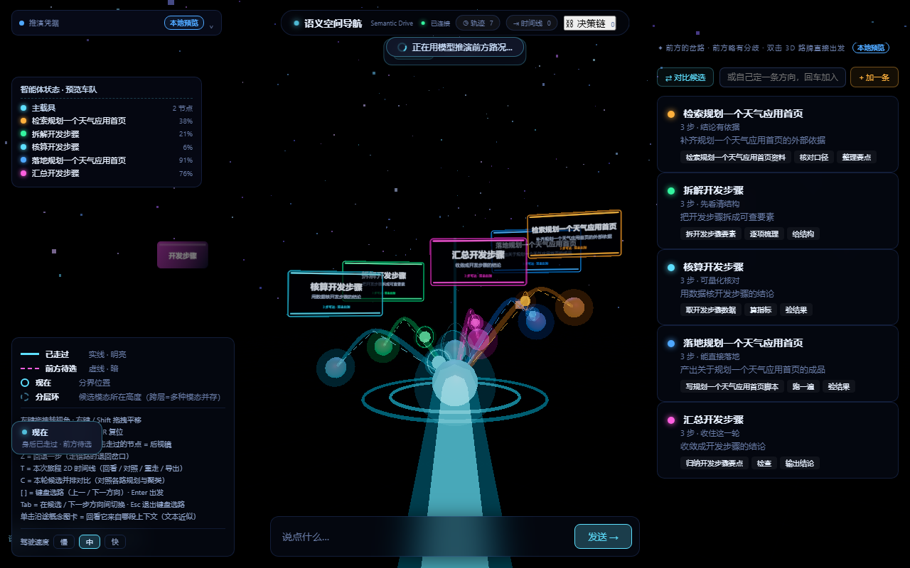

<div align="center">

# 🚗 Agent 3D Cockpit

**La collaboration avec un agent IA : de la lecture de réponses à la conduite d'un voyage.**

[](prototype/CHANGELOG.md)
[](LICENSE)

[简体中文](README.md) · [English](README.en.md) · [日本語](README.ja.md) · [Deutsch](README.de.md) · **Français** · [Español](README.es.md)


*▲ Capture d'exécution réelle : saisissez une question → le squelette de chemins latents apparaît → la prévision illumine cinq panneaux candidats. Le backend d'exécution est un modèle local ; la provenance de la prévision est honnêtement étiquetée dans l'interface.*

</div>

---

## Qu'est-ce que c'est ?

**Agent 3D Cockpit** est un prototype de recherche exécutable accompagné d'un cadre de recherche interdisciplinaire. La question centrale :

> Quand un agent IA travaille pour vous, comment **voir les directions, faire des choix, vérifier le progrès et revoir l'historique** — au lieu de fixer une barre de progression en devinant « que fait-il vraiment » ?

La collaboration est projetée sur une conduite 3D :

| Question de collaboration | Expression dans le cockpit | Votre capacité |
| --- | --- | --- |
| Que peut-il se passer ensuite ? | **Panneaux & bifurcations** devant | Comparer les directions avant de partir |
| En quoi les options diffèrent ? | Forme de route, disposition spatiale, panneau de comparaison | Comprendre les choix au lieu de cliquer « continuer » à l'aveugle |
| Où en sommes-nous ? | **Conduite + sortie de tokens en streaming** | Suivre les vrais signaux d'exécution |
| Qu'a produit cette étape ? | **Panneau d'arrivée + carte de résultat** (durée/tokens/provenance) | Ouvrir et vérifier l'artefact, pas seulement un badge « terminé » |
| Pourquoi sommes-nous ici ? | Trajectoire parcourue, timeline 2D, chaîne de décisions | Revoir, comparer, re-bifurquer depuis n'importe quel nœud |



## ✨ Fonctionnalités

- **Routes pilotées par la prévision** : le backend échantillonne des directions candidates et calcule la divergence — faible divergence = route droite, forte = bifurcations. La forme de la route *est* la visualisation de la structure sémantique, pas une décoration.
- **Regroupement sémantique** : repli de clusters synonymes + remplissage par point le plus éloigné — cinq panneaux sont cinq directions vraiment différentes.
- **Chaîne d'exécution honnête** : un seul appel LLM réel en streaming ; progression = longueur de sortie réelle. Quatre états `source` (`llm / fast / local / offline`) étiquetés par tour — les replis locaux ne se font jamais passer pour une inférence du modèle.
- **Provenance vérifiable** : cartes de résultat avec durée, tokens, chaîne d'exécution et source.
- **Mémoire multi-tours & replay** : registre par tour, timeline 2D (revoir / comparer / re-bifurquer / export JSON·CSV), chaîne de traçabilité des décisions.
- **L'interruption est un troisième état** : « Arrêter la génération » interrompt réellement le flux backend. Interrompu ≠ terminé ≠ échoué ; le texte partiel est préservé et étiqueté honnêtement.
- **Vue équivalente au clavier** : `[` `]` sélectionner, `Entrée` partir, `Tab` changer de groupe.
- **Appareil expérimental intégré** : `?mode=opaque / transparent-nolink / decorative / no-fingerprint` pour les groupes A/B/B0/B1/B2/C.
- **Boîte à outils MCP** : `tools/cockpit_mcp_server.py` expose le cockpit comme outils appelables par agent.
- **Anneau d'empreinte MoE** (branche de recherche) : signaux réels de routage d'experts encodés en anneau 3D (même prompt r=0.990, sujets différents max=0.079).

## 🛡️ L'honnêteté comme principe de conception

Nous avons audité notre propre prototype et découvert que les étapes intermédiaires de l'ancienne chaîne (« recherche », « vérification ») étaient du **théâtre** piloté par `sleep(0.09)` — la barre avançait, aucun travail n'avait lieu. L'audit, les preuves d'exécution et le correctif sont entièrement publics dans [docs/AUDIT.md](docs/AUDIT.md) et [docs/RUNTIME-AUDIT.md](docs/RUNTIME-AUDIT.md).

Quatre **critères de progrès substantiel (P1–P4)** en découlent, comme porte d'entrée avant tout développement :

| Critère | Doit répondre |
| --- | --- |
| **P1 Réel** | La tâche/l'artefact a-t-il vraiment changé ? |
| **P2 Vérifiable** | L'utilisateur peut-il le vérifier lui-même ? |
| **P3 Attribuable** | Quelle étape / qui l'a fait ? |
| **P4 Perceptible** | Est-ce reconnaissable dans l'interface ? |

Lignes rouges d'ingénierie : **pas de signaux de complétion fabriqués, pas de données fabriquées, l'interruption ne se fait jamais passer pour une complétion, le repli local jamais pour le modèle.**

## 🚀 Démarrage rapide

**Prérequis** : Python 3.10+ ; un endpoint LLM compatible OpenAI (llama.cpp local / Ollama / API cloud). Frontend sans build.

```bash
git clone https://github.com/showkeyjar/agent-3d-cockpit-research.git
cd agent-3d-cockpit-research/prototype
pip install -r requirements.txt

cd backend
LLM_BASE_URL=http://localhost:11434/v1 LLM_MODEL=your-model \
  uvicorn server:app --host 127.0.0.1 --port 8770
```

Ouvrez **http://127.0.0.1:8770/** et saisissez une question. Ou en un clic :

```bash
python tools/open_cockpit.py
```

> 💡 Pas de gros modèle local ? Un petit modèle Ollama (ex. `gemma3:1b`) suffit pour l'interaction complète ; l'interface étiquette honnêtement la provenance et les limites. L'endpoint LLM est aussi configurable **directement dans l'interface** (sans redémarrage).

Détails (variables d'environnement, clavier, tests) : [README English](README.en.md#-quick-start) et [prototype/README.md](prototype/README.md).

## 📚 Documentation de recherche

Résumé en français : [docs/i18n/RESEARCH-SUMMARY.fr.md](docs/i18n/RESEARCH-SUMMARY.fr.md)

Documents clés : [PROBLEM](docs/PROBLEM.md) · [EVIDENCE](docs/EVIDENCE.md) · [AUDIT](docs/AUDIT.md) · [RUNTIME-AUDIT](docs/RUNTIME-AUDIT.md) · [SUBDISCIPLINES](docs/SUBDISCIPLINES.md) · [M-EXPERIMENT](docs/M-EXPERIMENT.md) · [M3-ACCEPTANCE](docs/M3-ACCEPTANCE.md)

*Les documents de recherche primaires sont en chinois. Les PR de traduction sont les bienvenues.*

## 🗺️ Feuille de route

- [x] Chaîne d'exécution honnête (théâtre supprimé)
- [x] Système de vérifiabilité P2
- [x] Troisième état d'interruption + durcissement du cycle de vie WS
- [x] Anneau d'empreinte MoE
- [x] Appareil expérimental M1
- [ ] **M2 études humaines contrôlées** ← priorité actuelle
- [ ] M0 validation par réflexion à voix haute
- [ ] M3 checklist d'acceptation
- [ ] Segments de chaîne d'outils réels (Route A)

## 🤝 Contribuer

PR bienvenues ! Lisez d'abord [CONTRIBUTING.md](CONTRIBUTING.md) — règle centrale : **chaque changement doit répondre « lequel des P1–P4 fait-il avancer ? »**

## 📄 Licence

[MIT](LICENSE) © 2026 showkeyjar

---

<div align="center">

**La voiture peut être cool. Mais chaque route illuminée doit mener à quelque chose qui s'est réellement passé — et que l'utilisateur peut vérifier.**

</div>
