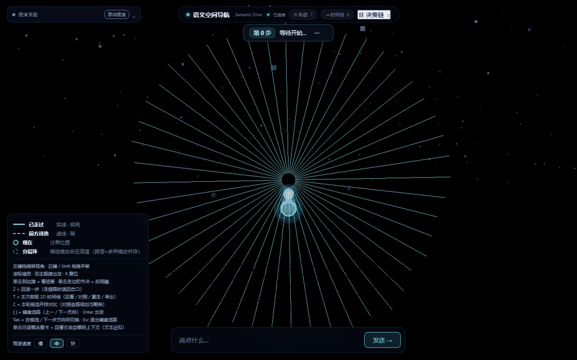

<div align="center">

# 🚗 Agent 3D Cockpit

**AIエージェントとの協働を「回答を読む」から「旅を運転する」へ。**

[](prototype/CHANGELOG.md)
[](LICENSE)

[简体中文](README.md) · [English](README.en.md) · **日本語** · [Deutsch](README.de.md) · [Français](README.fr.md) · [Español](README.es.md)



*▲ 実際のランタイムキャプチャ：質問を入力 → 潜在的なパスの骨格が現れる → 推論結果が5つの候補標識を点灯。実行バックエンドはローカルモデル、推論の出所はUIに正直に表示されます。*

</div>

---

## これは何？

**Agent 3D Cockpit** は、実行可能な研究プロトタイプと学際的研究フレームワークです。中心となる問い：

> AIエージェントがあなたの代わりに作業するとき、進捗バーを眺めて「何をしているのか」と推測するのではなく、**方向を見て、選択し、進捗を検証し、履歴を振り返る**にはどうすればよいか？

エージェントとの協働を3Dドライブにマッピングします：

| 協働の問い | コックピットでの表現 | 得られる能力 |
| --- | --- | --- |
| 次に何ができる？ | 前方の**道路標識と分岐** | 出発前に方向を比較 |
| 選択肢の違いは？ | 道路形状・空間配置・並列比較パネル | 闇雲に「続行」せず選択を理解 |
| 今どこまで進んだ？ | **走行 + トークンのストリーミング出力** | 実際の実行シグナルを追跡 |
| このステップの成果は？ | **到着標識 + 結果カード**（所要時間/トークン数/出所） | 「完了」だけでなく成果物を検証 |
| なぜここにいる？ | 走行軌跡・2Dタイムライン・決定チェーン | 任意のノードから振り返り・比較・再分岐 |


## ✨ 主な機能

- **推論駆動の道路**：候補方向をサンプリングし分歧度（divergence）を計算。差が小さければ直線路、大きければ分岐。道路形状は意味構造の可視化であり、装飾ではありません。
- **意味バケツ分け**：同義クラスタの折叠＋最遠点バックフィルで、5つの標識が本当に5つの異なる方向であることを保証。
- **正直な実行チェーン**：単一の実際のストリーミングLLM呼び出し。進捗＝実際の出力文字数。`source` 4状態（`llm / fast / local / offline`）を毎ラウンド正直に表示。ローカルフォールバックがモデル推論を騙ることは決してありません。
- **検証可能な出所**：結果カードに所要時間・トークン数・実行チェーン・出所を表示。
- **マルチターン記憶と再生**：ラウンド台帳、2Dタイムライン（振り返り/並列比較/再分岐/JSON·CSVエクスポート）、決定追跡チェーン。
- **中断は第三の状態**：「生成停止」はバックエンドのストリームを実際に中断。中断 ≠ 完了 ≠ 失敗。部分テキストを保持し正直にラベル付け。
- **キーボード等価ビュー**：`[` `]` で選択、`Enter` で出発、`Tab` でグループ切替。
- **実験装置内蔵**：`?mode=opaque / transparent-nolink / decorative / no-fingerprint` で A/B/B0/B1/B2/C 対照群を切替。
- **MCPツールセット**：`tools/cockpit_mcp_server.py` がコックピットをエージェント呼び出し可能なツールとして公開。
- **MoE指紋リング**（研究支線）：実際のエキスパートルーティング信号を3Dリングにエンコード（同プロンプト r=0.990、異テーマ max=0.079）。

## 🛡️ 正直さの設計

私たちは自分のプロトタイプを監査し、旧実行チェーンの中間ステップ（「検索」「検証」）が `sleep(0.09)` 駆動の**劇場**であることを発見しました。進捗バーは動くが、仕事は起きていなかったのです。監査・実行時証拠・修正は [docs/AUDIT.md](docs/AUDIT.md) と [docs/RUNTIME-AUDIT.md](docs/RUNTIME-AUDIT.md) に完全公開。

ここから4つの**実質的進捗基準（P1–P4）**を開発の事前ゲートとして確立：

| 基準 | 答えるべき問い |
| --- | --- |
| **P1 真実性** | タスク/成果物は実際に変わったか？ |
| **P2 検証可能** | ユーザーが自分で検証できるか？ |
| **P3 追跡可能** | どのステップ/誰がやったか？ |
| **P4 知覚可能** | UIで認識できるか？ |

工学レッドライン：**完了シグナルの捏造禁止、データの捏造禁止、中断を完了に偽装禁止、ローカルフォールバックをモデルに偽装禁止。**

## 🚀 クイックスタート

**要件**：Python 3.10+、OpenAI互換のLLMエンドポイント（ローカル llama.cpp / Ollama / クラウドAPI）。フロントエンドはビルド不要。

```bash
git clone https://github.com/showkeyjar/agent-3d-cockpit-research.git
cd agent-3d-cockpit-research/prototype
pip install -r requirements.txt

cd backend
LLM_BASE_URL=http://localhost:11434/v1 LLM_MODEL=your-model \
  uvicorn server:app --host 127.0.0.1 --port 8770
```

**http://127.0.0.1:8770/** を開いて質問を入力。または一键起動：

```bash
python tools/open_cockpit.py
```

> 💡 大きなローカルモデルがなくても、Ollama の小型モデル（例：`gemma3:1b`）で完全なインタラクションを体験できます。LLMエンドポイントは**UI内で直接設定**可能（再起動不要）。

環境変数・キーボード一覧・テスト手順の詳細は [English README](README.en.md#-quick-start) と [prototype/README.md](prototype/README.md) を参照。

## 📚 研究文档

研究概要（日本語）：[docs/i18n/RESEARCH-SUMMARY.ja.md](docs/i18n/RESEARCH-SUMMARY.ja.md)

主要文書：[PROBLEM](docs/PROBLEM.md) · [EVIDENCE](docs/EVIDENCE.md) · [AUDIT](docs/AUDIT.md) · [RUNTIME-AUDIT](docs/RUNTIME-AUDIT.md) · [SUBDISCIPLINES](docs/SUBDISCIPLINES.md) · [M-EXPERIMENT](docs/M-EXPERIMENT.md) · [M3-ACCEPTANCE](docs/M3-ACCEPTANCE.md)

*一次研究文書は中国語で書かれています。全文翻訳のPRを歓迎します。*

## 🗺️ ロードマップ

- [x] 実行チェーンの正直化（劇場除去）
- [x] P2検証体系（出所バー/比較/タイムライン/エクスポート）
- [x] 中断第三状態 + WSライフサイクル強化
- [x] MoE指紋リング
- [x] M1実験装置
- [ ] **M2 人間対照実験** ← 現在の主線
- [ ] M0 発話思考検証
- [ ] M3 受入チェックリスト記入
- [ ] 実ツールチェーン（Route A）

## 🤝 コントリビュート

PR歓迎！まず [CONTRIBUTING.md](CONTRIBUTING.md) をお読みください。核心ルール：**すべての変更は「P1–P4のどれを前進させるか」に答えること。**

## 📄 ライセンス

[MIT](LICENSE) © 2026 showkeyjar

---

<div align="center">

**車はクールでよい。しかし点灯するすべての道は、実際に起きたこと——そしてユーザーが検証できること——に通じていなければならない。**

</div>
