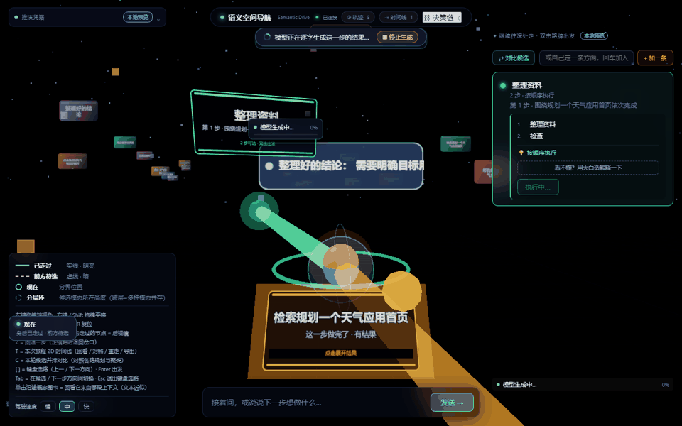

<div align="center">

# 🚗 Agent 3D Cockpit

**把与 AI 智能体的协作，从「读一串回答」变成「驾驶一段旅程」。**

*Turn agent collaboration from reading replies into driving a journey.*

[](prototype/CHANGELOG.md)
[](docs/PROBLEM.md)
[](prototype/requirements.txt)
[](LICENSE)
[](CONTRIBUTING.md)

**简体中文** · [English](README.en.md) · [日本語](README.ja.md) · [Deutsch](README.de.md) · [Français](README.fr.md) · [Español](README.es.md)

[快速开始](#-快速开始) · [核心思想](#-核心思想为什么是驾驶而不是聊天) · [诚实性设计](#-诚实性设计这个项目最特别的地方) · [研究文档](#-研究文档地图) · [路线图](#-路线图) · [参与贡献](#-参与贡献)


*▲ 真实运行录屏：输入问题 → 潜在路径骨架铺出 → 推演返回时点亮为五块候选路牌。执行后端为本地模型，推演来源在界面如实标注。*

</div>

---

## 这是什么

**Agent 3D Cockpit** 是一个可运行的研究原型 + 一套跨学科研究框架，探索一个问题：

> 当 AI 智能体替你干活时，你如何**看见方向、做出选择、核对进展、回看历史**——而不是盯着一个进度条猜测「它到底在干嘛」？

它把智能体协作映射成一场 3D 驾驶：

| 协作中的问题 | 驾驶舱中的表达 | 你得到的能力 |
| --- | --- | --- |
| 接下来可能做什么？ | 前方**路牌与岔口** | 出发前比较方向 |
| 不同方案差在哪里？ | 路形、空间位置、候选对比面板 | 理解选择，而非盲点「继续」 |
| 现在做到哪儿了？ | **行驶 + token 流式输出** | 跟随真实执行信号 |
| 这一轮得到什么？ | **到达牌 + 结果卡**（含耗时/tokens/来源凭据） | 打开产物核对，而非只看「完成」 |
| 为什么走到这里？ | 已走轨迹、2D 时间线、决策溯源链 | 回看、对照、从任意节点重新分叉 |


## ✨ 特性

- **前瞻推演铺路**：后端对候选方向采样、计算分歧度（divergence），差异小走直道、差异大分岔——路形是语义结构的可视化，不是装饰。
- **语义分桶**：同义簇折叠 + 最远回填，保证 5 块路牌是 5 个真正不同的方向，而非「查资料/检索资料/搜索资料」的换词复读。
- **诚实执行链**：单步真实 LLM 流式调用，进度 = 真实输出字数；`source` 四态（`llm / fast / local / offline`）逐轮如实标注，本地兜底绝不冒充模型推演。
- **可核对凭据**：结果卡带耗时、tokens、执行链、来源；推演凭据条展示分歧度 D、聚类映射、路形。
- **多轮记忆与复盘**：会话级逐轮账本、2D 时间线（回看/并排对照/分叉重走/导出 JSON·CSV）、决策溯源链。
- **中断是第三态**：「停止生成」真实掐断后端流式请求，中断 ≠ 完成 ≠ 失败，保留已生成的部分文本并如实标注。
- **键盘等价视图**：`[` `]` 选路、`Enter` 出发、`Tab` 切换候选组——3D 不是唯一通道。
- **实验装置内建**：`?mode=opaque / transparent-nolink / decorative / no-fingerprint` 一键切换 A/B/B0/B1/B2/C 对照组，服务真人实验。
- **MCP 工具集**：`tools/cockpit_mcp_server.py` 把驾驶舱封装成智能体可调用的工具（forecast / execute / health / open）。
- **MoE 指纹环**（研究支线）：真实专家路由信号编码为 3D 指纹环，同 prompt r=0.990、异题 max=0.079，可区分「模型真的换了思路」。



*▲ 真实运行录屏：选中「下一步」路牌 → 相机沿新路段行驶 → 落位后新到达牌与结果卡接管。*

## 🧭 核心思想：为什么是「驾驶」而不是「聊天」

聊天框擅长回答，却不擅长让人理解**方向之间的关系**：哪些是并列选择、哪些是先后依赖、哪些是走过又撤回的尝试。驾驶舱把时间轴展开成空间：

```
分歧 → 岔路      候选 → 路牌      执行 → 行驶
结果 → 到达点    历史 → 后视镜    重选 → 分叉重走
```

背后是两个学科交叉（详见 [docs/SUBDISCIPLINES.md](docs/SUBDISCIPLINES.md)）：

1. **向量空间上下文可视化**——候选方向在语义空间里是否真的不同（分桶、簇间距离）；
2. **3D 路径空间人机交互**——路径里的每次「前进」是否对应真实工作。

两者必须互相作证。若语义有进展而路径无感知、或路径很炫而执行是空的，项目称之为**双向断链**——这正是用户反馈「界面上没有实质性进展」的机制解释（待真人实验验证的假说）。

## 🛡️ 诚实性设计：这个项目最特别的地方

我们审计过自己的原型，发现旧执行链的中间步骤（「检索」「校验」）是 `sleep(0.09)` 驱动的**剧场**——进度条在动，工作没发生。审计结论、运行时证据与修复过程全部公开在 [docs/AUDIT.md](docs/AUDIT.md) 与 [docs/RUNTIME-AUDIT.md](docs/RUNTIME-AUDIT.md)。

运行时计时显示旧链路的 `task_update` 间隔整齐落在 90–100ms、零散布——sleep 的指纹；该记录中假节拍约占总时长 86%（仅为该记录的诊断数字）。修复后复测：整齐节拍消失，token 流覆盖执行时长的 60–70%。

由此确立了四条**实质进展判据（P1–P4）**，作为所有开发的先验闸门：

| 判据 | 必须回答 | 反例 |
| --- | --- | --- |
| **P1 真实性** | 任务/产物真的改变了吗？ | 只动路牌颜色，报告一个字没改 |
| **P2 可核对** | 用户能自己验证吗？ | 只有「已完成」，看不到产物与依据 |
| **P3 可追溯** | 是哪一步/谁做的？ | 把一次生成归因为没发生的检索+校验 |
| **P4 可感知** | 界面上认得出来吗？ | 后台干了活，界面只有抽象百分比 |

工程红线（贯穿所有版本）：**不新增伪造完成信号、不伪造数据、中断不冒充完成、本地兜底不冒充模型**。回归测试套件锁死这些不变量。


*▲ 结果卡：真实模型正文 + 凭据（耗时 / tokens / chain=output / source=llm）。*

## 🚀 快速开始

**依赖**：Python 3.10+；一个 OpenAI 兼容的 LLM 端点（本地 [llama.cpp](https://github.com/ggml-org/llama.cpp) / [Ollama](https://ollama.com) / 任意云端 API 均可）。前端零构建（原生 Three.js，vendor 已入库）。

```bash
git clone https://github.com/showkeyjar/agent-3d-cockpit-research.git
cd agent-3d-cockpit-research/prototype
pip install -r requirements.txt

# 启动后端（统一端口 8770）
cd backend
LLM_BASE_URL=http://localhost:11434/v1 LLM_MODEL=your-model \
  uvicorn server:app --host 127.0.0.1 --port 8770
```

打开 **http://127.0.0.1:8770/**，输入问题即可开始驾驶。也可以一键启动：

```bash
python tools/open_cockpit.py   # 探活→自动拉起后端→打开浏览器
```

> 💡 没有本地大模型？用 Ollama 跑一个小模型（如 `gemma3:1b`）即可体验完整交互；界面会如实标注模型来源与产物边界。LLM 端点也可以在**界面内直接配置**（`backend/llm_config.py`），无需重启。

### 环境变量

| 变量 | 默认 | 说明 |
| --- | --- | --- |
| `LLM_BASE_URL` | `http://localhost:8083/v1` | OpenAI 兼容端点 |
| `LLM_MODEL` | `local-primary` | 模型名/别名（与端点注册一致） |
| `LLM_API_KEY` | `EMPTY` | 云端 API 鉴权；本地端点留空 |
| `LLM_EMBEDDING_MODEL` | 空 | 配置后走真实 embedding（语义档 eps=0.38）；留空用 hashed-TF 词面向量（eps=0.60，界面如实标注「文本近似」） |
| `PORT` | `8770` | 后端端口（全仓库统一约定） |
| `COCKPIT_CORS_ORIGINS` | 回环白名单 | CORS 白名单，**不要用 `*`** |

完整说明见 [prototype/README.md](prototype/README.md)。

### 键盘速查

| 键 | 作用 |
| --- | --- |
| `[` / `]` | 候选组内选路 |
| `Enter` | 出发（执行选中方向） |
| `Tab` | 当前候选 ↔ 下一步方向 切换 |
| `C` | 候选并排对比面板 |
| `T` | 2D 时间线（回看/对照/重走/导出） |
| `D` | 决策溯源链 |
| `I` / `V` | 沉浸模式 / 立体分屏 |
| `Z` | 回退一步 |
| `Esc` | 停止生成 / 退出面板 |

## 📁 仓库结构

```
├── prototype/            # 可运行实证原型（v0.9.49.2）
│   ├── index.html        #   3D 驾驶舱前端（Three.js，零构建）
│   ├── backend/          #   FastAPI + WebSocket 后端（执行链/账本/记忆）
│   ├── forecaster/       #   前瞻推演器（采样/分桶/分歧度/3D 投影）
│   ├── DESIGN.md         #   设计文档（版本演进的事实源）
│   └── CHANGELOG.md      #   变更日志（按版本倒序）
├── docs/                 # 研究文档（问题/证据/审计/实验协议/验收清单）
│   ├── i18n/             #   多语言研究概要
│   └── assets/           #   README 配图（真实运行截图与录屏）
├── tools/                # MCP 服务器 / 一键启动 / 实验采集装置 / 审计脚本
├── blog/                 # 科普博文（含实跑 GIF，中文）
└── .github/              # Issue / PR 模板
```

## 📚 研究文档地图

| 文档 | 内容 |
| --- | --- |
| [PROBLEM.md](docs/PROBLEM.md) | 研究问题本体：把「没有实质性进展」固化为可检验问题 + P1–P4 工作定义 |
| [EVIDENCE.md](docs/EVIDENCE.md) | 证据链：四轮呈现层迭代归类 + 反馈跃迁 + 拐点判定 |
| [AUDIT.md](docs/AUDIT.md) | 静态审计：逐条对照代码打分，发现「中间步骤是剧场」 |
| [RUNTIME-AUDIT.md](docs/RUNTIME-AUDIT.md) | 运行时实证：WS 计时钉死 sleep 节拍；路线 B 修复复测 |
| [SUBDISCIPLINES.md](docs/SUBDISCIPLINES.md) | 学科框架：两学科定义 + 双向断链机制 |
| [RESEARCH-PLAN.md](docs/RESEARCH-PLAN.md) | 假设清单（可证伪）+ 实验协议 + 里程碑 |
| [M-EXPERIMENT.md](docs/M-EXPERIMENT.md) | 真人实验协议：A/B/B0/B1/B2/C 组、三类任务、量表、伦理 |
| [M3-ACCEPTANCE.md](docs/M3-ACCEPTANCE.md) | 实质进展验收清单：P0→P4 + 四级证据 + 开发自检模板 |
| [CROSS-TURN-PROGRESS.md](docs/CROSS-TURN-PROGRESS.md) | 跨轮次进展：三层不同步的可复算事实 + RQ1–RQ5 |
| [VISION-DECOMPOSITION.md](docs/VISION-DECOMPOSITION.md) | 三愿景功能拆分与优先级路线 |

多语言研究概要（附[术语对照表](docs/i18n/GLOSSARY.md)）：[English](docs/i18n/RESEARCH-SUMMARY.en.md) · [日本語](docs/i18n/RESEARCH-SUMMARY.ja.md) · [Deutsch](docs/i18n/RESEARCH-SUMMARY.de.md) · [Français](docs/i18n/RESEARCH-SUMMARY.fr.md) · [Español](docs/i18n/RESEARCH-SUMMARY.es.md)

## 🧪 测试

```bash
# 后端（不占模型槽，fake-LLM）
cd prototype/backend && pytest

# 前端回归（需 Node + 本机 Chromium；详见 prototype/README.md）
cd prototype && npm install
node test_honesty.js       # 诚实性护栏
node test_cancel.js        # 中断契约
node test_timeline.js      # 多轮账本
node verify_opaque.js      # 实验操纵完整性
```

回归红线：执行链语义、3D 几何不变量（机位贴轨 `camOffRail≈0`）、中断态、实验操纵一致性——任何 PR 不得回退。

## 🗺️ 路线图

- [x] 执行链诚实化（路线 B：单步真实流式，剧场移除）
- [x] P2 可核对体系（凭据条 / 对比面板 / 时间线 / 导出）
- [x] 中断第三态 + WS 生命周期加固
- [x] MoE 指纹环（真实专家路由信号可视化）
- [x] M1 实验装置（六组操纵 + 采集工具 + 量表）
- [ ] **M2 真人对照实验**（A/B 呈现效应、B/C 执行真实性、B/B2 指纹环单变量）← 当前主线
- [ ] M0 出声思维验证（用户「没有实质进展」的内心指向）
- [ ] M3 验收清单填实 + 假设状态回写
- [ ] 真实工具链路段（路线 A：检索/代码执行/校验接真实后端，每步可核对）
- [ ] 真实 embedding 语义档的领域校准

## 🤝 参与贡献

欢迎 PR！请先读 [CONTRIBUTING.md](CONTRIBUTING.md)——核心要求只有一条：**每个改动先回答「它推进了 P1–P4 的哪一条」**，只推进呈现层的改动默认视为未构成实质进展，需给出理由。

- 🐛 [报告 Bug](.github/ISSUE_TEMPLATE/bug_report.md)
- 💡 [提出功能](.github/ISSUE_TEMPLATE/feature_request.md)（附 P1–P4 自检）
- 🔬 [参与实验](docs/M-EXPERIMENT.md)（被试招募见 §10）

## 📖 引用

如果本项目对你的研究有帮助，欢迎引用：

```bibtex
@software{agent3dcockpit2026,
  title  = {Agent 3D Cockpit: Perceiving and Measuring Substantive Progress
            in Agent Collaboration via Vector-Space Context Visualization
            and 3D Path-Space HCI},
  author = {showkeyjar},
  year   = {2026},
  url    = {https://github.com/showkeyjar/agent-3d-cockpit-research}
}
```

## 📄 许可证

[MIT](LICENSE) © 2026 showkeyjar

---

<div align="center">

**车可以很酷。但每一段被点亮的路，都应该通向一件真正发生过、并且用户能够核对的事。**

*The car can be cool. But every lit-up road must lead to something that actually happened — and that the user can verify.*

</div>
