# 如果 Vibe Coding 不是聊天，而是一场 3D 驾驶？

> 当智能体的候选方向变成岔路、执行过程变成行驶、每次选择变成可回看的轨迹，我们是否能从“等 AI 给答案”，走向“驾驶一场人机协作”？

*封面为 AI 生成概念图。下文素材分三类并逐图标注：① AI 概念图；② 本地注入候选的界面演示（标「演示」）；③ **连接真实后端后的实跑录屏与截图**（标「实跑」）——本次实跑以本机 Ollama 上的小模型为执行后端，推演走 fast 本地通道并如实显示「本地预览」，执行链为真实模型流式输出。*

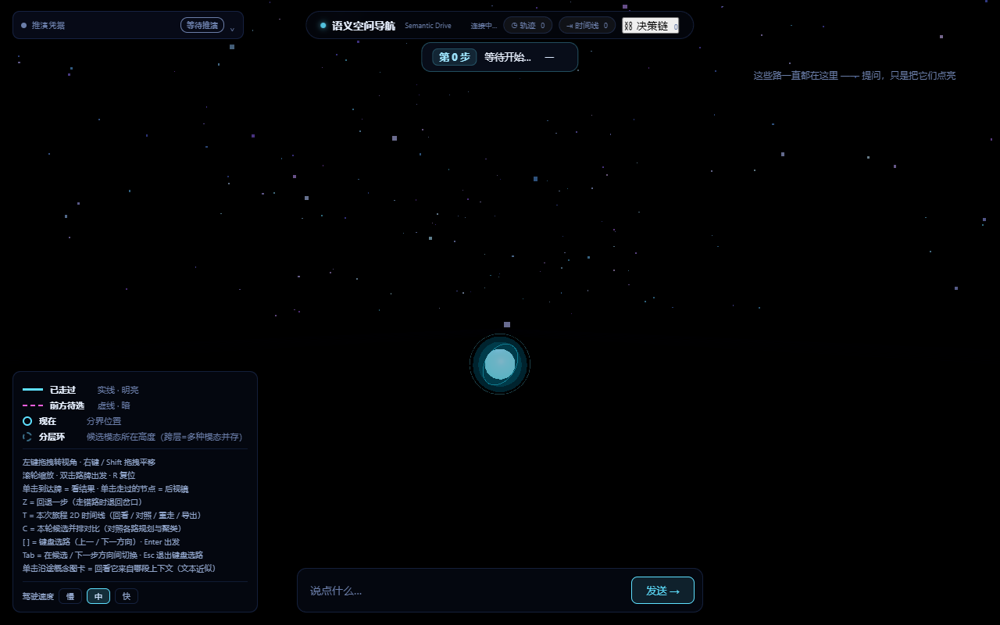

*原型实景 ①｜尚未提问的驾驶舱空场。浏览器实际渲染，无模拟结果。*

## 01｜今天的 Vibe Coding，像隔着无线电指挥一辆看不见的车

你说：“给这个页面做一个更清爽的布局。”智能体开始写代码。片刻后，它告诉你改好了。你追问：它为什么选这个布局？有没有更大胆的版本？刚才改动属于整个产品的哪一步？下一步是补交互、调性能，还是先验证用户看不看得懂？

这些问题往往挤在一条聊天记录里。聊天框能容纳代码、解释和命令，却很难让人一眼看见**方向之间的关系**：哪些是并列选择，哪些是先后依赖，哪些是已经走过又撤回的尝试。人虽然握着“发送”键，却未必握着一张地图。

这个项目提出一个有野心的逆转：**不要只让 AI 告诉你它要做什么；让你在空间里看见可能的路线，并亲自驾驶智能体走向其中一条。**

它不是把聊天窗口贴到一辆 3D 小车旁边。它尝试重新定义交互对象：从“下一条消息”，变成“下一段旅程”。如果这一设想成立，Vibe Coding 就不只是用自然语言写代码，而成为一种可以**预看、选择、跟随、核对和复盘**的协作方式。

## 02｜一次提问，怎样长出道路？

设想任务是：“帮我做一个天气应用的首页。”在聊天框里，这是一句等待回答的提示词；在驾驶舱里，它可能是一个即将铺开的路口。

前方出现几块路牌：**先确定信息架构**、**先做可运行页面**、**先建立视觉风格**、**先核对天气数据来源**。它们不是四个装饰性的按钮，而应当是可区分的行动方向。你可以先阅读每条路的理由与步骤，再决定驶入哪一条；也可以提出自己的方向，而不必受限于机器给出的选项。

项目原型的基本交互已经围绕这个比喻搭建：前瞻器生成候选并估算分歧；差异小时呈现更接近直道的关系，差异明显时铺出岔路；选中的路牌触发执行；完成后，结果与行驶后的节点关联；继续探索又会在前方出现新的方向。原型还尝试把候选并排比较、键盘选路和自定义方向纳入这套交互。

*实跑动画 ①｜输入「帮我规划一个天气应用首页的开发步骤」后，暗色路径骨架先铺出，推演返回时点亮为五块彩色路牌。真实后端在环；本批候选来自 fast 本地通道，界面如实标「本地预览」。*

*实跑截图 ①｜同一时刻的完整界面：3D 岔路、右侧候选卡、顶部「本地预览」凭据条。*

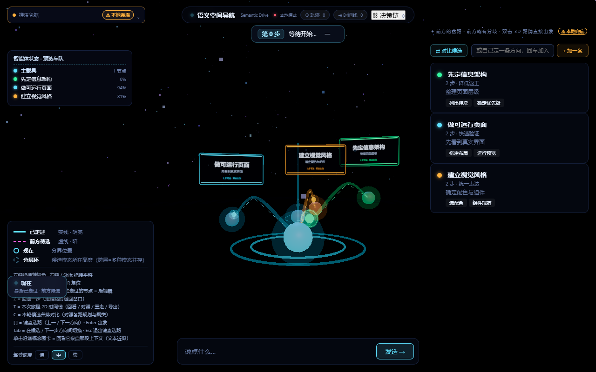

*原型实景 ②｜实际 WebGL 场景、岔路与候选卡。候选「先定信息架构 / 做可运行页面 / 建立视觉风格」由本地脚本注入作界面演示；顶部「本地兜底」是真实显示的来源标记，不代表模型已推演。*

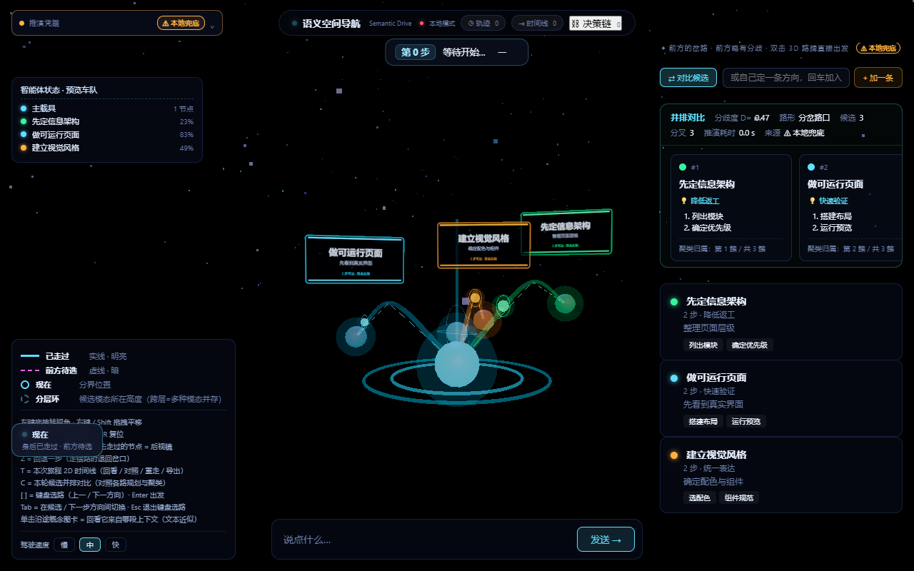

*原型实景 ③｜点击「对比候选」后的实际面板；候选数据同为本地演示注入。*

把流程翻译成驾驶语言，是一次对 AI 产品界面的重新分工：

| 智能体协作中的问题 | 3D 驾驶中的表达 | 用户得到的能力 |
| --- | --- | --- |
| 接下来可能做什么？ | 前方路牌与岔口 | 出发前比较方向 |
| 不同方案差在哪里？ | 路形、位置及候选说明 | 理解选择，而非盲点“继续” |
| 现在做到哪儿了？ | 行驶中的状态与挂件 | 跟随执行；前提是信号真实 |
| 这一轮得到什么？ | 到达牌与结果卡 | 打开产物而非只看“完成” |
| 为什么走到这里？ | 已走轨迹、时间线、决策链 | 回看、对照与重新分叉 |

**这才是最颠覆的地方：智能体不再只是对话框另一端的答题者，而是你可以与之共同导航的行动系统。**

## 03｜从“提示词工程”到“方向盘工程”

传统提示词交互把大量决策压进一句话。你要在开始前想好风格、功能、边界、验证方式；说漏了，就再写一轮提示词补救。3D 驾驶的想象是把部分决策外显：你不必一次写出整条路线，而是看见前方几条不同的路，判断这一步先往哪里开。

对 vibe coding 而言，这意味着一种新的协作节奏。比如做天气应用：先驶入“可运行页面”得到首版；到达之后，前方分出“补数据接入”“调整移动端布局”“增加极端天气提醒”。若发现页面好看却不可用，就从历史节点回看先前选择，再决定沿另一方向重走。这不是让 AI 自动替你决定产品，而是让**人的意图在每个关键岔口重新进入系统**。

空间还有一项聊天流难以天然提供的能力：记忆不再只是一大段往上滚的文字。走过的路可以成为可定位的节点；你能把两个结果并排对照，知道哪一轮来自模型、哪一轮只是本地快速预览，以及某次“重新走”究竟执行了新任务还是重放了旧答案。

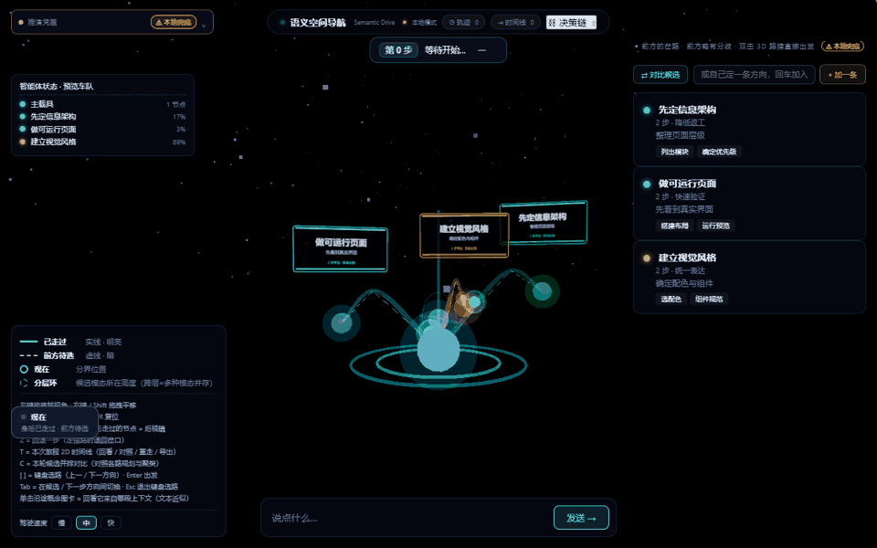

*浏览器实录动画 ①｜从岔路切换到候选并排对比。捕获的是原型真实渲染帧；候选内容为标注的本地演示数据。*

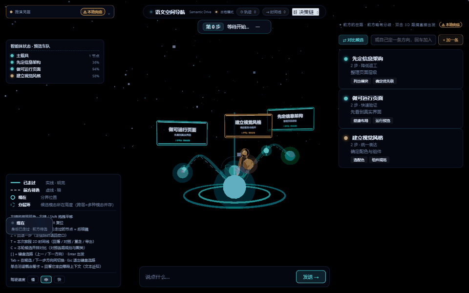

*浏览器实录动画 ②｜按键选择方向时的真实界面变化，非执行任务录屏。*

### 实跑：选中一条路，看它真的执行

下面两段来自主动连接真实后端后的完整执行：键盘选中候选 → 真实模型流式生成 → 到达 → 点开结果卡 → 沿「未来路牌」走第二段。执行后端为本机小模型，输出是真实生成文本；推演来源在界面上如实区分。

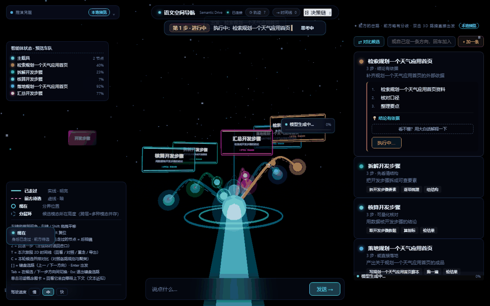

*实跑动画 ②｜第一步「检索规划一个天气应用首页」的真实执行：任务条流式文字逐步增长，随后到达牌立起、结果卡展开真实模型正文。*

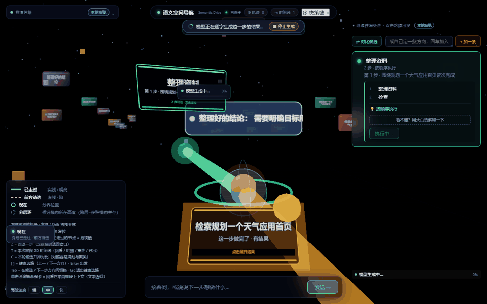

*实跑动画 ③｜选中「整理资料」未来路牌后的第二段真实行驶：相机沿新路段推进，前方出现「正在推演下一方向」占位牌，落位后新到达牌与结果卡接管。*

但需要清楚：**空间隐喻本身不是能力。** 如果“先接数据”和“先美化页面”只是措辞不同、实际执行相同，岔路就没有决策价值；如果用户自己加的方向无法真正执行，方向盘也只是一个摆件。交互革命取决于语义上有真分歧、执行上有真动作、结果上可核对。

## 04｜驾驶舱里的两个坐标系

原型背后可以用两个坐标系来理解。第一是**语义空间**：候选之间是否真的代表不同任务方向？项目通过同义簇折叠、分桶和距离度量等机制，尝试避免把“查资料、检索资料、搜索资料”当作三条独立道路。第二是**路径空间**：这些方向如何在 3D 中被摆放、选中、驶入并留下轨迹？

这两个坐标系必须互相翻译。若语义空间区分出了多个有意义的方向，却只在画面里排成几块没有结构差异的牌，用户仍不知如何选择。反过来，若空间里道路纵横交错，背后却没有真正不同的任务或执行，那只是在给空白镀上一层霓虹。

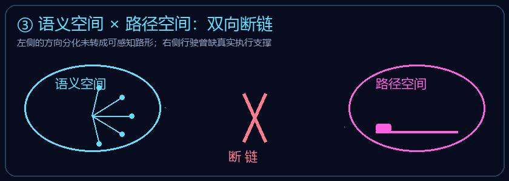

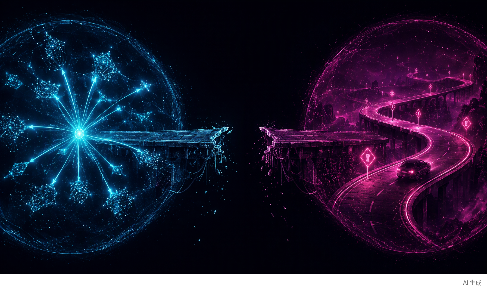

*上图均是解释性示意。项目将这种语义变化与路径位移未能互相作证的情况称为“双向断链”；它是设计与研究假说，不是已由真人实验确认的用户心理机制。*

于是，未来真正值得探索的不是“做出更多道路”，而是**让道路的几何关系承担决策信息**：哪些方向接近、哪些方向分歧明显、哪些步骤需要先后执行、哪一条是从旧节点分叉而来。把空间当成信息结构，而不只是舞台布景，驾驶隐喻才有可能比聊天框多出一种认知带宽。

## 05｜真正的杀手级场景：把代码任务开成一段可回看的旅程

现在把视角从抽象的“智能体协作”缩小到一天的开发工作。你对智能体说：“为现有应用加一个登录页，并能在手机上用。”若交互仍是一条聊天线，你通常只能读它的计划，再读它的代码，靠自己在多个回复之间拼接因果。

在驾驶舱的理想流程中，出发前就能看到几种路径：沿既有组件体系实现、先做低保真交互验证、先梳理认证接口。选择“沿既有组件体系实现”后，**执行期间显示的应是实际事件**：哪份文件被修改、哪项构建或测试正在跑、哪里失败、结果是什么。到达时，你能点开变更清单和预览，而不是只收到一枚“已完成”徽章。

这是一种设计目标，**不是当前原型已经具备完整代码编辑、测试和验证工具链的声明**。项目在旧执行链审计中恰好发现，挂着“检索”“工具”“校验”名字的中间环节并没有相应的真实工作。要把这个驾驶舱用于更深度的 vibe coding，必须把道路接到真实开发工具和可检查产物上；否则演示越像真正的开发流程，越容易误导人。

想象真正落地之后的体验：你选择了先做页面，沿途发现移动端溢出，路面提示“布局回归失败”；你停下车，看见失败截图和对应文件；智能体提出“修响应式栅格”与“缩减卡片密度”两条可比较的路。你不必用冗长的新提示词重述全部背景，只需驾驶到更符合产品意图的方向。**这不是替代代码审查，而是把审查与选择嵌入旅程。**

## 06｜最难的问题：怎样证明车真的在开？

这也是项目最值得公开的自我修正。早期版本做了候选数量、预览车队、沉浸与立体、语义分桶等迭代。用户却反馈：“界面上感觉没有实质性进展。”这个反馈不能被轻易等同于“3D 没用”；它提示开发者检查更基础的事：驾驶舱展示的每一步是否对应后台的真实改变。

旧执行链审计发现，中间步骤用 `asyncio.sleep(0.09)` 更新进度，再由模板生成“已检索”“已校验”之类文案；真正的模型调用发生在尾部输出。运行时记录里，中间事件呈现规律的约 90—100 毫秒节拍。项目以特定记录估计假节拍约占总时长的 86%；这个数字只适用于该次诊断，不是产品所有场景的通用比例。

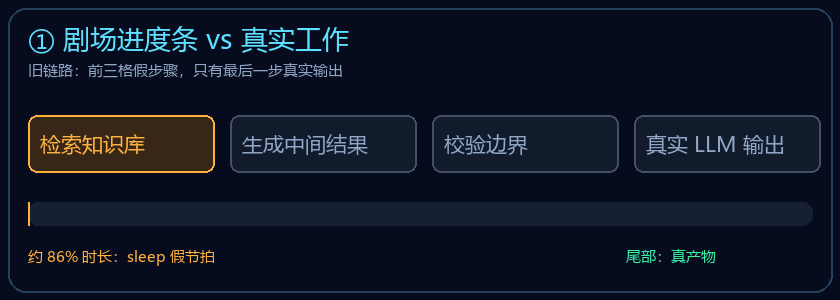

这段教训不应夺走本文主角的位置。它真正说明的是：**3D 驾驶越能让人相信“我们正在前进”，就越需要严格限定什么时候可以把一次视觉移动称作工作进展。** 对 vibe coding 而言，路段不是动画时间轴，而应是一条包含输入、操作、结果与证据的链。没有做检索，就不要亮起“检索完成”；没有跑测试，就不要把抵达终点等同于“验证通过”。

项目选择先做一次诚实的减法：v0.9.12 把没有真实工作的中间链删除，收敛为单次真实模型请求与 token 流式输出，归因只标一项 `output`。复测中，整齐的假节拍指纹消失。删除多余路段不是驾驶理念的失败，而是在为未来的**真路段**清出空间。

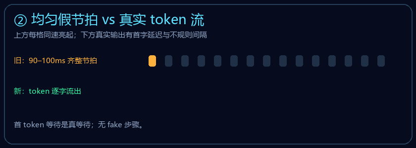

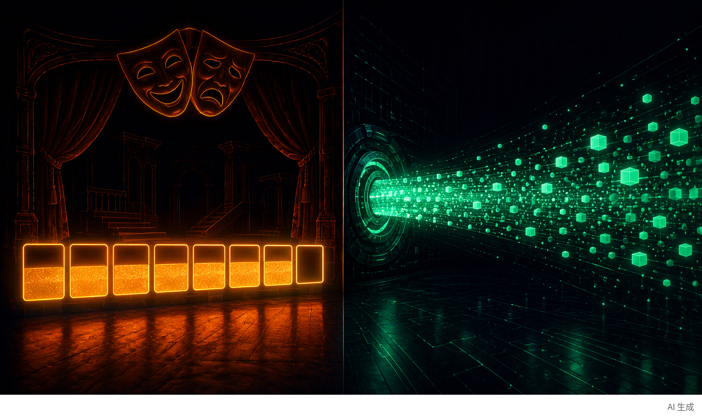

*GIF 是解释性动画，图片为 AI 生成概念图，均不是运行时录屏。*

## 07｜把“已完成”变成可以追问的事实

一套可信的智能体驾驶舱，不能只回答“走到哪里”，还必须回答四个问题：**这一步真做了吗？结果能核对吗？是谁、哪一步做的？用户在界面上认出来了吗？** 项目将它们称为 P1 真实性、P2 可核对、P3 可追溯、P4 可感知。它们是一套工作定义，而非已经经真人实验盖章的终极公式。

| 一次“到达”应该回答 | 在 vibe coding 中可能对应什么 |
| --- | --- |
| 实际改变了什么？ | 变更的文件、代码、页面或配置 |
| 用户如何核对？ | diff、运行预览、测试结果及失败信息 |
| 这是谁的成果？ | 用户所选方向、智能体执行步骤、来源标记 |
| 到达点怎样表达？ | 对应结果的空间锚点和清晰的状态，而非万能绿勾 |

这也是为什么原型后来逐渐加入来源凭据、逐轮账本、候选对比、决策链、取消生成等机制。它们看上去不如飞驰的霓虹车队吸睛，却能让人回答“上一轮我选了什么”“这轮是否真的重跑”“模型没有参与时牌面为何仍出现”等问题。**方向盘不仅要能转，还要能让驾驶者对后果负责。**

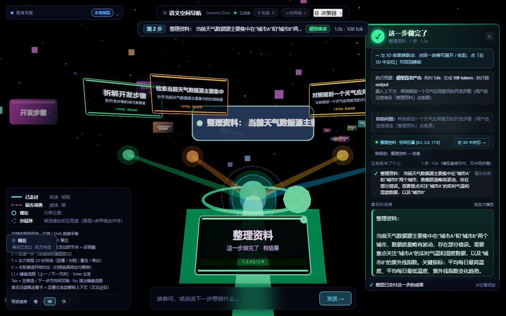

*实跑截图 ②｜第二步到达后的结果卡：真实模型正文 + 执行凭据（耗时、tokens、链=output、来源=llm）。*

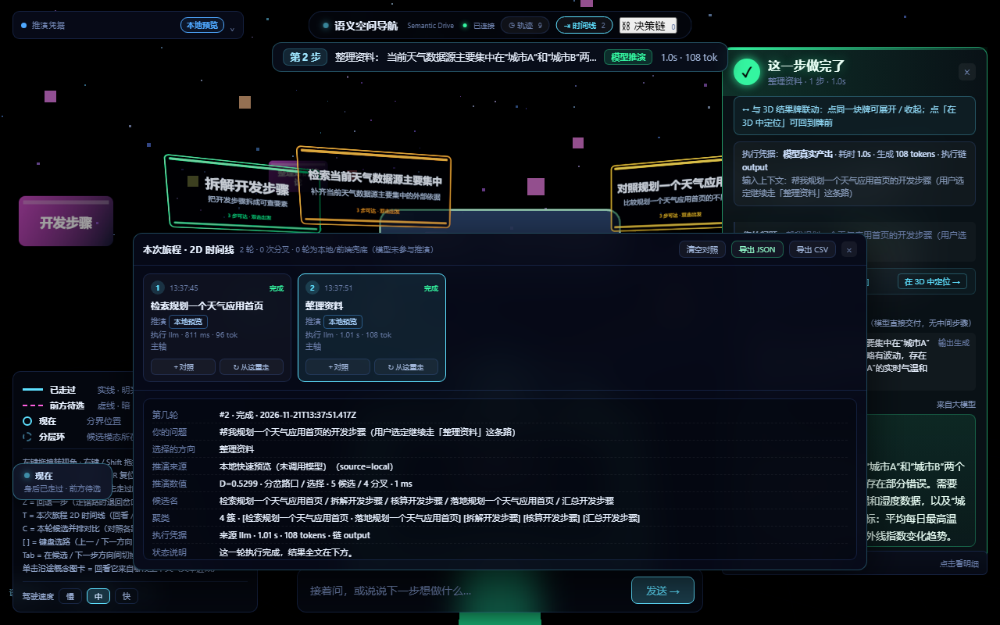

*实跑截图 ③｜2D 时间线：两轮执行逐轮可回看；「推演=本地预览 / 执行=llm」分开标注，不混同。*

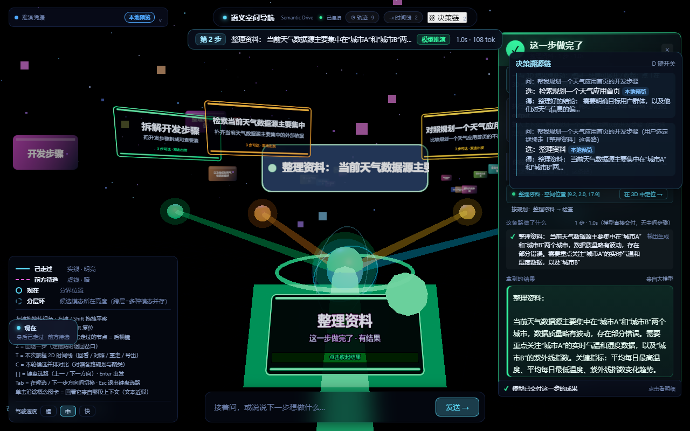

*实跑截图 ④｜决策链按「问→选→得」列出每步选择，对应 P3 可追溯。*

尤其要区分“真实生成”和“可靠结果”。起草一段页面文案，模型写出的草稿本身可供检视；分析一份没有提供的业务数据，模型即使真的输出了具体数字，也不能说分析已完成。对于缺数据、模型未参与、执行中断等情况，驾驶舱需要相应的状态，而不是无条件让车辆抵达发光终点。

## 08｜这不是要取代聊天，而是为复杂协作增加一个空间层

并非每句“把按钮改成蓝色”都需要一座三维高速公路。简单直答、单文件微调、快速问答，聊天框可能更轻。3D 驾驶真正有机会发挥作用的，是**有多条有意义的路线、需要连续决策、成果值得反复比较**的任务。

例如一个产品从“想法”走向“可用原型”：决定先验证需求还是先写前端，选择低保真还是直接做交互，遭遇构建失败后决定修复或回退，在多个版本间对比最终体验。这里的认知负担不是“看不懂一个回复”，而是“看不清整个过程里发生了哪些决策”。把选择、状态和历史放进空间，才可能比线性聊天带来增益。

但“可能”仍需测量。研究已经准备了执行透明与不透明的对照协议，以及起草、附数据分析、缺数据分析等不同任务类型；真人出声思维与对照实验在项目文档所述阶段仍待执行。因此，不能宣称用户已经证明 3D 一定胜过聊天，也不能把“更酷”当成“更高效”。理想的验证不只是问喜不喜欢，而是看用户能否更快找到产物、更准确指出来源、更稳妥地选择下一步。

## 09｜最后想象一次真正的“驾驶”

你打开项目，不是面对一条漫长而模糊的聊天记录，而是站在上次工作的路口。身后是已经完成和中断的尝试，前方是几条有清楚代价与目标的路线。你选中一条，智能体开始执行；车辆的移动不由预设秒数驱动，而由真实事件推进。某一步失败，路不会假装畅通；结果可用，终点也不只会发光——它能打开真实产物。

这才是这项研究最值得被讨论的愿景：**把与智能体的交互、尤其是多轮 vibe coding，从“读一串回答”变成“驾驶一个有方向、有证据、有记忆的工作空间”。** 自我审计不是它的主题，而是它不沦为漂亮玩具的底线。

车可以很酷。但每一段被点亮的路，都应该通向一件真正发生过、并且用户能够核对的事。

---

### 项目开源地址

本文所有截图、GIF 与审计结论都来自同一个公开仓库，欢迎直接核对代码与文档：

**GitHub：<https://github.com/showkeyjar/agent-3d-cockpit-research>**

仓库包含研究文档（`docs/`）、可运行原型（`prototype/`）与本文配图素材（`blog/assets/`）。

---

### 创作与证据说明

本文依据项目 `README.md`、`docs/SUBDISCIPLINES.md`、`docs/EVIDENCE.md`、`docs/AUDIT.md`、`docs/RUNTIME-AUDIT.md`、`docs/RESEARCH-PLAN.md` 及 `prototype/DESIGN.md` 撰写。天气应用、登录页等 vibe coding 片段是用于说明交互设想的假想场景，不代表当前原型已具备完整的代码编辑与测试闭环。关于双向断链及用户进展感的解释仍需真人实验验证。

三张静态配图为 AI 生成概念图；`01/02/03-*.gif` 为解释性动画，非录屏。`real-*` 系列为浏览器实际渲染的界面演示（候选由本地脚本注入，界面标「本地兜底」）。`hw-*` 系列为**连接真实后端后的实跑**：执行后端为本机 Ollama 小模型（gemma3:1b-it-qat），执行链为真实模型流式输出（界面凭据显示 source=llm、tokens、耗时）；推演走 fast 本地通道并如实标「本地预览」。实跑输出为真实生成文本，但小模型产物质量有限，仅作交互与真实性演示，不代表产品级答案质量。未将测试钩子模拟结果冒充实跑。请保留 Markdown 与 `assets/` 文件夹的相对目录结构。
